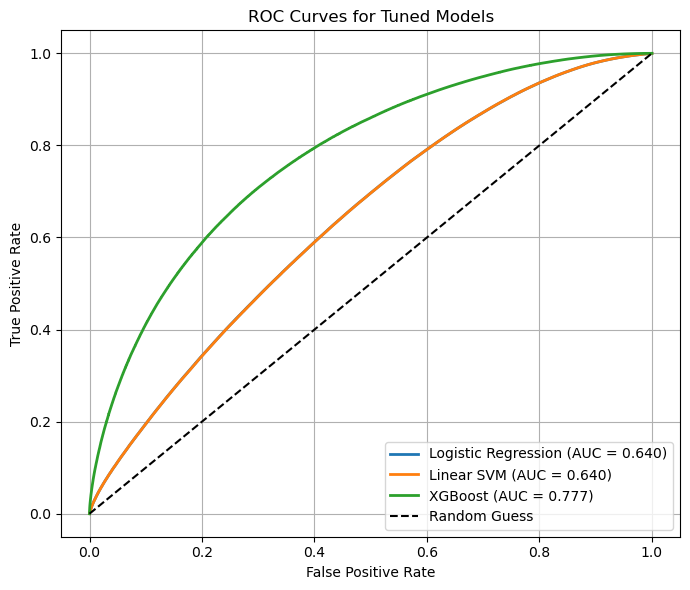
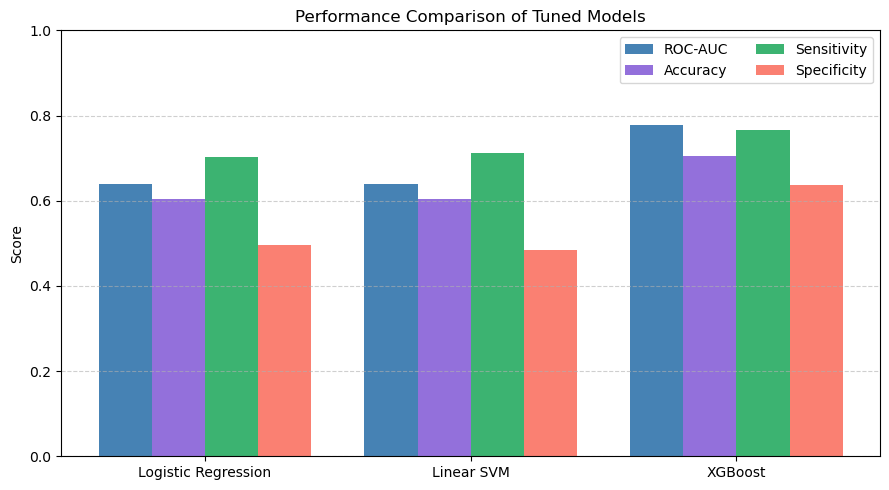

# Higgs Boson Event Classification with GPU-Accelerated Machine Learning

An end-to-end machine learning pipeline, run entirely on the GPU with **NVIDIA RAPIDS**, that separates Higgs boson signal events from background events in the 11-million-event HIGGS dataset.

The best model, a tuned **XGBoost**, reaches a **ROC-AUC of 0.777** and **70.5% accuracy** on 2.2 million held-out test events.

*Coursework for the Accelerated Machine Learning module, MSc Artificial Intelligence, Liverpool John Moores University.*

## The problem

In particle physics experiments, most collisions are "background" noise, and only a few produce a Higgs boson. The task is binary classification: given 28 measurements of a collision event, predict whether it is a **signal** (Higgs boson produced) or **background** event.

With about 11 million events, the dataset is too large to process comfortably on a CPU, so the whole pipeline uses GPU-accelerated libraries.

## Dataset

[HIGGS dataset](https://archive.ics.uci.edu/dataset/280/higgs) from the UCI Machine Learning Repository (Baldi, Sadowski and Whiteson, 2014).

- **About 11 million events**, simulated with Monte Carlo methods.
- **28 features:** 21 low-level kinematic measurements (lepton and jet momentum, angles, b-tags, missing energy) and 7 high-level mass features derived from them.
- **Roughly balanced classes:** 53% signal, 47% background.
- No missing values.

The dataset (about 2.6 GB) is not included in this repository. Download it from the link above.

## Approach

1. **Exploratory analysis on the GPU (cuDF):** class balance, correlation matrix, feature–label correlation, box plots, pair plots and mutual information.
2. **Preprocessing (cuML):** stratified 80/20 train–test split (8.8M / 2.2M events), standard scaling fitted on training data only, and **PCA** reducing 28 features to 23 components while keeping 95% of the variance.
3. **Models:**
   - **XGBoost** on the GPU, tuned with a grid search (3-fold cross-validation on a 500,000-event sample) over tree depth, learning rate, subsampling and column sampling.
   - **Logistic Regression** and **Linear SVM** (cuML) as linear baselines, tuned over the regularisation strength C.
4. **Evaluation:** ROC-AUC, accuracy, sensitivity, specificity and confusion matrices on the test set.
5. **Inference:** the final model outputs a signal probability for new events, using the same scaling and PCA steps.

## Results

| Model | ROC-AUC | Accuracy | Sensitivity (signal) | Specificity (background) |
| --- | --- | --- | --- | --- |
| **XGBoost (tuned)** | **0.777** | **70.5%** | **76.5%** | **63.7%** |
| Logistic Regression | 0.640 | 60.4% | 70.2% | 49.5% |
| Linear SVM | 0.640 | 60.5% | 71.2% | 48.4% |





**Key findings**

- **XGBoost clearly outperforms the linear models** on every metric, because the boundary between signal and background is non-linear.
- **Tuning helped XGBoost** (AUC 0.769 → 0.777) but made almost no difference to the linear models, whose limit is the linear decision boundary itself.
- **The high-level mass features** (`m_bb`, `m_wwbb`, `m_wbb`) carry the most information, which matches the physics motivation behind them.

## How to run

This notebook needs an **NVIDIA GPU with CUDA** and the RAPIDS libraries.

1. Install RAPIDS (cuDF, cuML, CuPy) by following the [RAPIDS installation guide](https://docs.rapids.ai/install). The notebook was run with RAPIDS 24.02.
2. Install the other libraries:
   ```bash
   pip install -r requirements.txt
   ```
3. Download the HIGGS dataset, unzip it, and save it next to the notebook as `Partical.csv` (the file name the notebook expects).
4. Open the notebook:
   ```bash
   jupyter notebook higgs_classification.ipynb
   ```

## Tools

Python · NVIDIA RAPIDS (cuDF, cuML, CuPy) · XGBoost · scikit-learn · Matplotlib · seaborn · Jupyter
